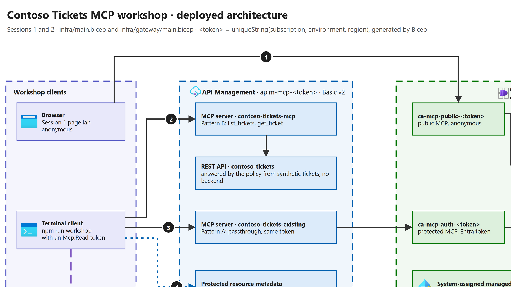

# Session 2 - MCP in enterprise and Azure architectures

[Workshop](../../README.md) · **10:15–10:45 · 30 minutes** · [Presenter page](presentation.html)

Overview of the main options for integrating and exposing MCP servers within an
enterprise architecture, including Azure API Management (APIM). It starts from the
Contoso Tickets server of [session 1](../01-mcp-fondamentaux/README.md) and ends where
[session 3](../03-security/README.md) begins: whose rights the agent uses.

| Duration | Topic | Page chapter |
| --- | --- | --- |
| 3 min | Four decisions per MCP server: host, expose, discover, consume | [Lesson 1](presentation.html#decisions) |
| 4 min | Where it runs: this morning's Container Apps, and the other Azure hosts | [Lesson 2](presentation.html#hosting) |
| 6 min | One front door: from the open server to a governed gateway (animation) | [Lesson 3](presentation.html#front-door) |
| 5 min | Follow the badge: one token per hop, from sign-in to the ticket (animation) | [Lesson 4](presentation.html#token) |
| 4 min | Two ways to expose with APIM: an existing server, or a REST API as MCP | [Lesson 5](presentation.html#patterns) |
| 3 min | Find it, then use it: API Center, Foundry catalog, five checks | [Lesson 6](presentation.html#discover) |
| 5 min | Demo: the session 1 terminal client, through the gateway | [Demo](presentation.html#demo) |

## The message

For every MCP server, an enterprise takes four decisions: **where it runs**, **how
clients reach it**, **how teams find it** and **who consumes it**. The team owns the
code and where it runs. The platform owns the front door, the identity and the inventory.

Each lesson opens with one plain sentence for the room, then gives the presenter the
technical detail. Read the plain sentence first; open the detail only if asked.

## Present it yourself

Lessons 1 to 6 need nothing deployed: open the page, use the arrow keys, and read the plain
sentence of each step out loud. The two animations are where the room understands the
architecture: one shows **where** a call goes, the other shows **which badge** each hop carries.

| Part | What you need | What to say, in one sentence |
| --- | --- | --- |
| Lessons 1 and 2 | The page only | "Same tickets as this morning; four questions decide who owns what." |
| Lesson 3 animation | The page only; press **Play** or the numbered steps | "One address, one badge per API, the servers stay behind the door." |
| Lesson 4 animation | The page only | "Each hop has its own badge, for its own audience. Nobody passes a badge along." |
| Lessons 5 and 6 | The page only | "Write MCP code only when tools need logic; register the gateway, never the backend." |
| Demo | The gateway deployed and rehearsed (below) | "Same client as this morning: without a badge 401, with a badge CT-1002." |

If the gateway is not deployed, skip the demo and replay the Lesson 3 and 4 animations: they
show the same 401, 403 and authorized calls, labeled as illustrations.

## Who deploys what



[diagrams/deployed-architecture.drawio](diagrams/deployed-architecture.drawio) is the source; the SVG and PNG are
exported from it (draw.io Desktop: `draw.io --export --format svg --embed-svg-images --border 10` and
`--format png --scale 2 --border 10`). Icons come from [az-icons.com](https://az-icons.com/) (Azure Architecture
Icons, July 2026), except Microsoft Entra ID ([MsiconsCollections](https://aka.ms/MsiconsCollections)).
Update the diagram when the Bicep changes a component, an identity or a call path.

| Component | Deployed by | How | Needed for |
| --- | --- | --- | --- |
| Container Apps environment, registry, public MCP, protected MCP, internal ticket API | Workshop owner (Solene) | [infra/main.bicep](../../infra/main.bicep), then the image build and redeploy | Sessions 1, 3, 6; pattern A |
| Entra API registration: `Mcp.Read` scope and role, `Mcp.Backend.Read`, Azure CLI pre-authorized | Workshop owner | [infra/prepare-identity.mjs](../../infra/prepare-identity.mjs), then assign `Mcp.Backend.Read` to the MCP apps' identities | Every protected call; the demo token |
| API Management gateway, both MCP servers, metadata | Workshop owner, in the same resource group | [infra/gateway/main.bicep](../../infra/gateway/main.bicep) with `entraTenantId` = the workshop tenant, `entraClientId` = the API client ID above and `protectedMcpOrigin` = `https://<protectedAppFqdn>` (output of `infra/main.bicep`) | The demo; session 6 |
| API Center entry | Workshop owner, optional | Azure portal, manual (Preview) | Lesson 6, session 6 |
| Rehearsal and presentation of the gateway | Session 2 presenter | Reader on the resource group, and a user in the workshop tenant for the demo token | The demo |
| A full private copy of all the rows above | Anyone (presenter, owner), in their own non-production subscription | One command: [infra/deploy-all.ps1](../../infra/deploy-all.ps1) (see below) | Rehearsal without depending on the owner; a backup demo |
| Presenter pages | Nobody | GitHub Pages serves `sessions/` | All sessions |
| Hands-on resources at 14:30 | Each participant, in their own non-production subscription | The [90-minute afternoon path](https://web-mcp-host01-f80ce789cb05568a-portal.azurewebsites.net/?lang=en#/tracks) of the self-paced guide: modules 01 to 03, 04 as a stretch, always 99 | The hands-on workshop |

One tenant, one owner and one clean-up: the workshop owner deploys and deletes the gateway
with the Container Apps, because session 6 relies on it. The session 2 presenter needs only
Reader on the resource group and a user in the workshop tenant. The hands-on guide asks
participants to clone [olivMertens/governed-mcp-workshop](https://github.com/olivMertens/governed-mcp-workshop).

The gateway can also live in another subscription or tenant:
`validate-azure-ad-token` trusts the tenant you name, not the tenant of the gateway. Then set
`entraTenantId` explicitly (the template defaults to the deployment tenant), and close the
direct-backend gap of session 6 by allowing that gateway's outbound addresses on the Container App.

## Checked against Microsoft Learn (2026-10-20)

| Statement on the page | Learn page |
| --- | --- |
| MCP servers: Developer, Basic, Standard, Premium and the v2 tiers; not in workspaces | [MCP servers in API Management](https://learn.microsoft.com/azure/api-management/mcp-server-overview) |
| Existing server: tools and resources, no prompts; MCP 2025-06-18 or later; Streamable HTTP or SSE | [Expose an existing MCP server](https://learn.microsoft.com/azure/api-management/expose-existing-mcp-server) |
| REST API as MCP: tools only, one operation per tool | [Expose a REST API as an MCP server](https://learn.microsoft.com/azure/api-management/export-rest-mcp-server) |
| Never read `context.Response.Body`; log 0 front-end response bytes | Both pages above |
| `validate-azure-ad-token` in all tiers; `rate-limit-by-key` in Basic v2 | [validate-azure-ad-token](https://learn.microsoft.com/azure/api-management/validate-azure-ad-token-policy), [rate-limit-by-key](https://learn.microsoft.com/azure/api-management/rate-limit-by-key-policy) |
| Inbound Entra token, headers forwarded to the backend | [Secure access to MCP servers](https://learn.microsoft.com/azure/api-management/secure-mcp-servers) |
| `aud`, `scp`, `roles`, v2 issuer | [Access token reference](https://learn.microsoft.com/entra/identity-platform/access-token-claims-reference), [Scopes and permissions](https://learn.microsoft.com/entra/identity-platform/scopes-oidc) |
| The server's own badge for the ticket API | [Container Apps managed identities](https://learn.microsoft.com/azure/container-apps/managed-identity) |
| Bicep shapes, API version `2025-09-01-preview` | [Manage MCP servers programmatically](https://learn.microsoft.com/azure/api-management/manage-mcp-servers-rest-api) |
| Registry and catalog (Preview) | [API Center](https://learn.microsoft.com/azure/api-center/register-discover-mcp-server), [Foundry private tool catalog](https://learn.microsoft.com/azure/foundry/agents/how-to/private-tool-catalog) |

The passthrough forwarding the same `Authorization` header to a backend that validates it again
was also verified live in [olivMertens/governed-mcp-workshop](https://github.com/olivMertens/governed-mcp-workshop)
module 04 (2026-10-20).

## What stays the same all day

Session 2 changes the address, never the business contract:

| Session 1 | Session 2 through API Management |
| --- | --- |
| `list_tickets` → `GET /tickets` | Same tool, same operation (`list-tickets`) |
| `get_ticket({ticketId})` → `GET /tickets/{ticketId}` | Same tool, same operation (`get-ticket`) |
| CT-1001, CT-1002, CT-1003 | The same three synthetic tickets; CT-1002 returns CT-1002 |
| Malformed ID 400 `INVALID_ID`, unknown ID 404 `TICKET_NOT_FOUND` | Same RFC 9457 problems |
| Protected mode: Entra v2 token for this API, `Mcp.Read`, 401 then 403 | Same rules, checked by the gateway first |

## Two patterns on the same gateway

- **Pattern A, existing MCP server.** API Management forwards calls to the protected
  Container App (passthrough). The server keeps its code and checks the same token
  again. API Management passes tools and resources, not prompts. Choose it when tools
  need their own logic, several calls or a managed identity.
- **Pattern B, REST API as MCP (Preview).** API Management builds the MCP server from the
  API operations: nobody writes MCP code. Tools only, one operation per tool. The gateway
  answers from the same synthetic tickets as `src/data/contosoTickets.ts`, so the demo
  needs no backend; a test fails if they drift.

Both add what the server alone cannot: one public address, a call budget per caller
(HTTP 429), and a 401 challenge naming the Protected Resource Metadata
([RFC 9728](https://www.rfc-editor.org/rfc/rfc9728)) so that VS Code finds where to sign
in. No subscription key: access depends on the Entra token only.

## One command: deploy everything in your own subscription

To rehearse alone, or to keep a backup demo, deploy a private copy of the whole chain with
[infra/deploy-all.ps1](../../infra/deploy-all.ps1) (PowerShell 7, on Windows, Linux or macOS).
You need Azure CLI, Node.js 20+, Owner on a non-production subscription, and the right to
create app registrations in your tenant.

```powershell
npm ci
az login --tenant '<your-tenant-id>'
./infra/deploy-all.ps1 -SubscriptionId '<subscription-id>' -PublisherEmail 'team@example.com'
```

The script shows its plan and waits for `yes`. Then it runs the same building blocks as
above, in order: the Entra API ([prepare-identity.mjs](../../infra/prepare-identity.mjs)),
the hosting ([infra/main.bicep](../../infra/main.bicep)), the `Mcp.Backend.Read` role for
the two MCP identities, the image build, the redeploy, and the gateway. It ends with checks:
`HTTP 401` without a token, then ticket `CT-1002` with an `Mcp.Read` token, directly and
through the gateway. It creates no secret, prints no token, and keeps its private state in
the ignored `.copilot-azure/` folder. Run it again to resume after an error.
Add `-SkipGateway` to stop before API Management (much faster and cheaper), and `-AlwaysReady`
to keep one public MCP and one API replica warm on the day. `-ConsoleOrigin` (default
`https://solenecodes.github.io`) is the only browser origin the public MCP accepts, for the
session 1 page lab. Every Azure resource and nested deployment name is generated by Bicep from
a unique token; the script reads the names back from the deployment outputs.

If API Management keeps answering `502` while creating the MCP tools (seen once on a new Basic v2
instance), the script cancels the gateway deployment after `-StuckMinutes` (default 10) instead of
waiting more than an hour. It then prints the rerun command with `-ToolRevision 2`, which creates
the tools under new resource names. Clients still see `list_tickets` and `get_ticket`. Use it only
in that case: on a working gateway it would add a second copy of each tool.

Clean up the same day: `./infra/deploy-all.ps1 -SubscriptionId '<subscription-id>' -Destroy`
deletes the resource group, purges the API Management instance and deletes the Entra
application, and only if they carry this deployment's tag.

## Prepare the gateway (workshop owner, before the day)

The gateway is optional and separate from [infra/main.bicep](../../infra/main.bicep).
The workshop owner deploys it into the existing resource group after the Container Apps and
the Entra API registration ([prepare-identity.mjs](../../infra/prepare-identity.mjs)). Copy
[infra/gateway/main.parameters.json](../../infra/gateway/main.parameters.json) to an
ignored file and replace every placeholder: a team or example
publisher address, the workshop tenant ID, the API client ID, and the HTTPS origin of the
protected Container App (leave it empty for pattern B only). The API Management name defaults
to `apim-mcp-<uniqueString(resource group ID)>`; add `apimName` only to override it.

```sh
az deployment group what-if --resource-group '<resource-group>' \
  --template-file infra/gateway/main.bicep --parameters @<your-gateway-parameters>.json
az deployment group create --resource-group '<resource-group>' \
  --template-file infra/gateway/main.bicep --parameters @<your-gateway-parameters>.json
```

Review the what-if first: one API Management service, two REST operations, two MCP
servers (one with pattern A), two tools and the metadata API. Basic v2 is enough;
creation takes several minutes and the service is billed while it exists. Delete it the
same day, or keep it only until session 6.

Then the session 2 presenter rehearses the [demo](presentation.html#demo) from the venue
network, signed in with a user of the workshop tenant (`az login --tenant <workshop-tenant-id>`).
The copy panels use the workshop gateway by default (`defaultGateway` and `defaultClientId` in
[architecture-steps.mjs](architecture-steps.mjs)). For another deployment, open the page as
`presentation.html?gateway=<apim-name>.azure-api.net&clientId=<api-client-id>#demo`
(`deploy-all.ps1` prints this link). Only an `*.azure-api.net` host and a UUID are accepted.
After redeploying the gateway under a new name, update the two defaults.

1. `--anonymous tools` through the gateway: `HTTP 401`.
2. The metadata URL: the gateway URL as resource, the tenant, the `Mcp.Read` scope.
3. With a token: two tools, then `get_ticket` CT-1002 returns CT-1002.
4. Portal: API Management → MCP Servers → `contoso-tickets-mcp` → Tools and Policies.

Keep a screen recording as a fallback. If the gateway is not deployed, say so and show
the 401/403 animation of the session 3 preview instead; never present the animation as a
live call.

## Gateway contract for session 6

[Session 6](../06-hands-on/README.md) observes prepared controls. With this gateway:

| Observation | Expected result | Status |
| --- | --- | --- |
| Call without a token | 401 with `WWW-Authenticate: Bearer resource_metadata=...` | Verified live (2026-10-20) |
| Valid token without `Mcp.Read` | 403 `MISSING_MCP_READ_PERMISSION` | Authored |
| Burst above `rateLimitCalls` per period | 429 with `Retry-After` | Verified live: 429 after about 30 calls (the count is approximate) |
| Pattern B `get_ticket` CT-1002 / CT-9999 / malformed | Ticket CT-1002 / a problem with `status: 404` / a problem with `status: 400` | Verified live. The 404 and 400 arrive as text inside a normal tool result (`isError: false`), not as HTTP errors: API Management passes the REST answer back to the model |
| Pattern A (pass-through) `get_ticket` CT-1002 | Ticket CT-1002 | Verified live |
| Direct call to the protected Container App | **Not blocked yet**: it still answers with a valid token. Close it with [ingress IP restrictions](https://learn.microsoft.com/azure/container-apps/ip-restrictions) | Gap |
| Gateway logs in Application Insights | One `AppRequests` row per MCP request (`gen_ai.operation.name`, `gen_ai.tool.name`, duration, status), plus an `AppTraces` row with `caller.oid` and `caller.type` joined by `OperationId`. 0 bytes of any body, no client IP, MCP payload logging off ([monitor MCP traffic](https://learn.microsoft.com/azure/api-management/monitor-mcp-servers)) | Verified live (2026-10-21). `api.type` reads `mcp-backend` (pattern B) or `pass-through-mcp` (pattern A), not `Mcp` as in the Learn samples: filter on `gen_ai.operation.name` |
| API Center registration | Manual, Preview; register the gateway URL only | Manual |

"Authored" means built and tested offline (Bicep build and lint, `tests/gateway.test.ts`).
"Verified live" means observed on 2026-10-20 on a gateway deployed by
[infra/deploy-all.ps1](../../infra/deploy-all.ps1). Close the remaining gap before session 6 promises
"gateway only": restrict the Container App ingress to the gateway.

The gateway sends its telemetry with its own managed identity (Monitoring Metrics Publisher on
Application Insights, local authentication disabled): no instrumentation key exists. Tool calls
with who asked, from the Log Analytics workspace `log-mcp-<token>`:

```kusto
AppRequests
| where Properties["gen_ai.operation.name"] == "tools/call"
| join kind=leftouter (AppTraces
    | project OperationId, caller = tostring(Properties["caller.oid"])) on OperationId
| project TimeGenerated, server = tostring(split(Name, "/")[1]),
    tool = tostring(Properties["gen_ai.tool.name"]), caller, DurationMs, ResultCode
```

Allow 2 to 3 minutes of ingestion delay. Set `enableAppInsights=false` to deploy the gateway without telemetry.

## Boundaries

- API Management MCP servers and API version `2025-09-01-preview` are **Preview**; so are
  MCP registration in API Center and the Foundry private tool catalog.
- MCP servers are not available in API Management workspaces. Policies on an MCP server
  must never read the response body: it would break streaming.
- Pattern B tool errors: verified live on 2026-10-20. The generated MCP server returns a REST
  404 or 400 as text inside a normal tool result (`isError: false`). The problem body stays
  readable (`status`, `title`, `detail`), so the model can explain it.
- The page never calls the gateway and never asks for a token. The demo token goes
  straight into an environment variable and is removed with `unset MCP_TOKEN`.
- Resource shapes follow Microsoft Learn ([Manage MCP servers programmatically](https://learn.microsoft.com/azure/api-management/manage-mcp-servers-rest-api))
  except where the live service disagrees. Re-checked on Basic v2 on 2026-10-20:
  - `mcpProperties.endpoints` is a **map** (`{ message: { uriTemplate: '/mcp' } }`). The array
    shown in Learn and in the Bicep type is rejected with `400 ValidationError`.
  - A passthrough needs a **backend entity** and `backendId`, which is missing from the Bicep type.
    With only `serviceUrl`, as in the Learn sample, `tools/list` returns an empty list and nothing
    is forwarded.
  - Tools are created **one at a time** (`@batchSize(1)`). Creating both in parallel on a new
    instance returned `502 Bad Gateway`, and the tool resource names stayed unusable on that
    instance. The MCP name that clients see is `displayName`
    (`list_tickets`, `get_ticket`); the resource name carries a unique suffix.
  - First seen in [olivMertens/governed-mcp-workshop](https://github.com/olivMertens/governed-mcp-workshop) (module 04, Standard v2).

## Sources

- [About MCP servers in Azure API Management](https://learn.microsoft.com/azure/api-management/mcp-server-overview)
- [Expose and govern an existing MCP server](https://learn.microsoft.com/azure/api-management/expose-existing-mcp-server)
- [Expose a REST API in API Management as an MCP server](https://learn.microsoft.com/azure/api-management/export-rest-mcp-server)
- [Manage MCP servers programmatically in API Management](https://learn.microsoft.com/azure/api-management/manage-mcp-servers-rest-api)
- [Choose an Azure service for your MCP server](https://learn.microsoft.com/azure/container-apps/mcp-choosing-azure-service)
- [Register and discover MCP servers in Azure API Center](https://learn.microsoft.com/azure/api-center/register-discover-mcp-server)
- [Create a private tool catalog in Foundry (preview)](https://learn.microsoft.com/azure/foundry/agents/how-to/private-tool-catalog)
- Policy patterns adapted from [Azure-Samples/AI-Gateway, lab mcp-prm-oauth](https://github.com/Azure-Samples/AI-Gateway/tree/1679e3137d2fe7592d2a668d77ff71550d35b69e/labs/mcp-prm-oauth),
  MIT License, Copyright (c) Microsoft Corporation.

Last verified: 2026-10-20.
